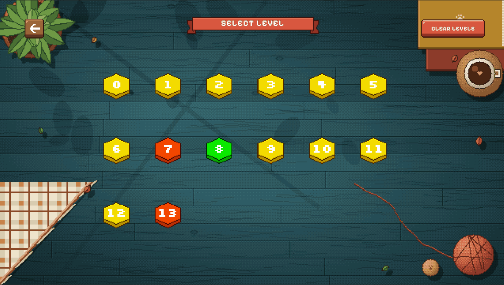
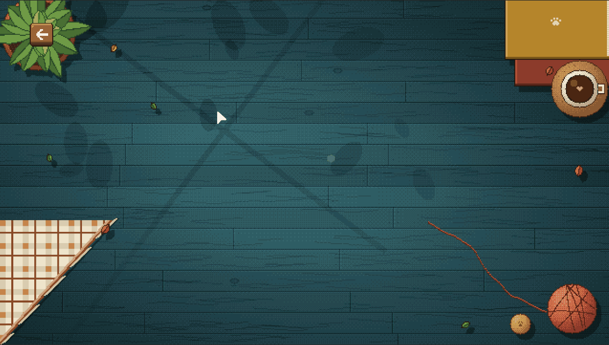
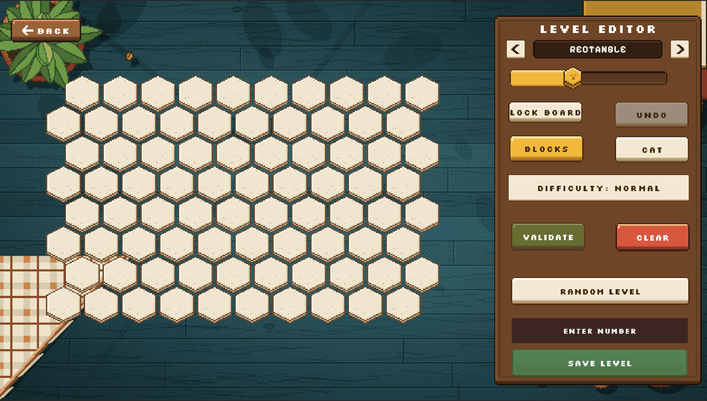
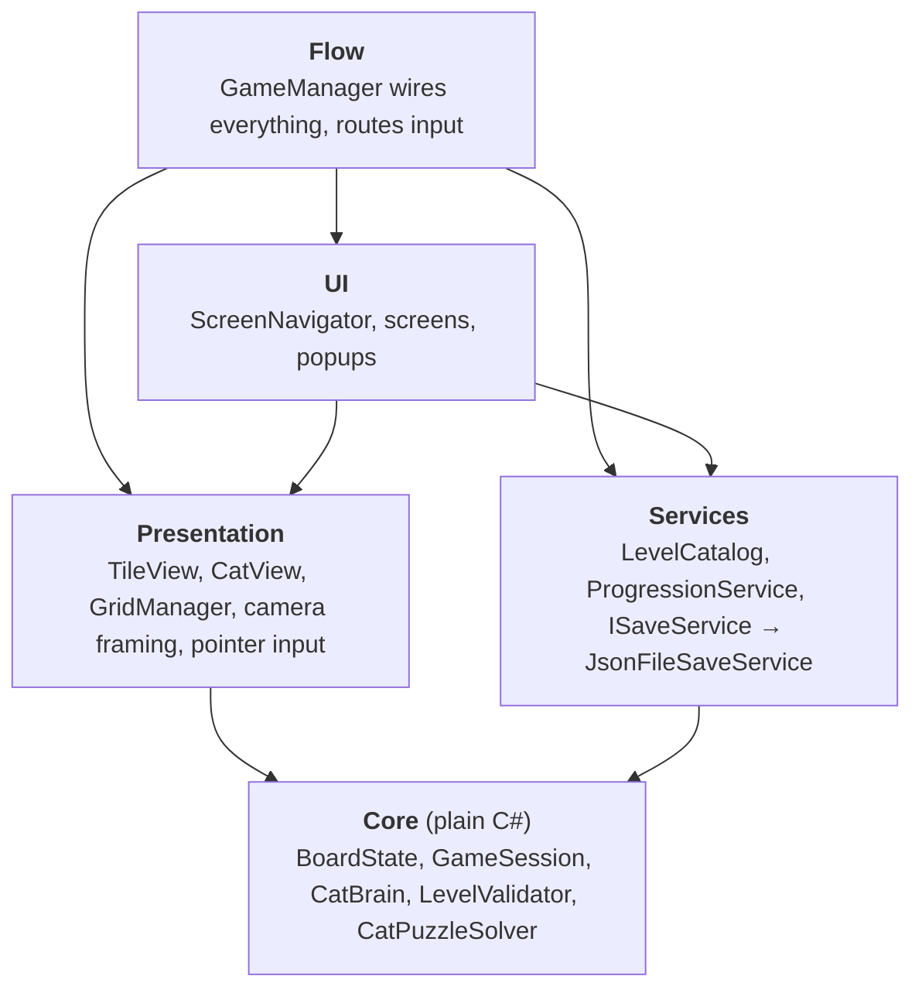
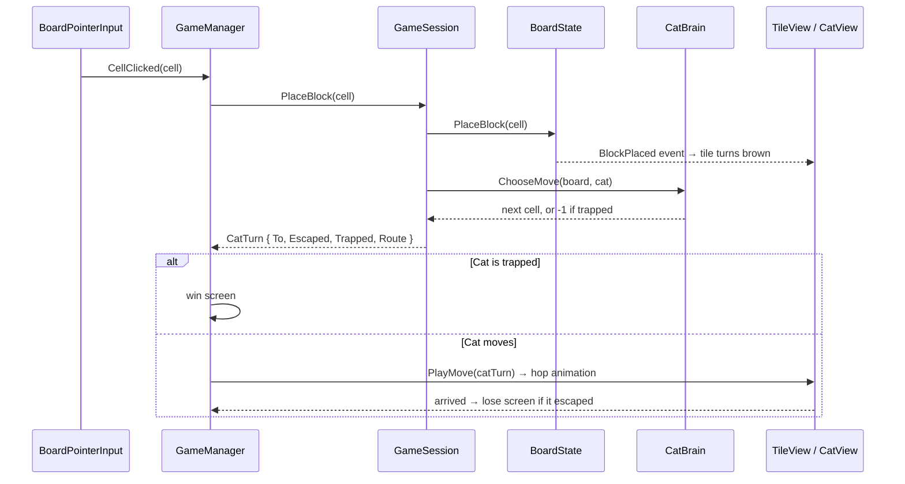

# Trap The Cat

A hex-grid puzzle game in Unity with a cat AI at three difficulty levels, a level editor with a built-in puzzle solver, and a playable ad build.

**[▶ Play on itch.io](https://mk55a.itch.io/trap-the-cat)** · **[▶ Play the playable ad](https://assets.lunalabs.io/uploads/apps/build/20029179/ff604628bde0e9d60c13f4f039dce50a/031a69f9aea72bcaa723bb616c51e2b0.html)**

## Gameplay

| Trap the cat | Or watch it escape |
|---|---|
|  |  |

## Highlights

- **Cat AI with three strategies**, chosen by level difficulty. The Normal cat uses max-flow to count how many blocks it would take to trap it, and reacts as that number drops.
- **A puzzle solver** that proves a level is winnable before it can be saved, by playing the real cat AI against every likely player move.
- **Level editor** with square, rectangle, hexagon and circle boards, saved as JSON.
- **Game rules in plain C#**, separate from Unity rendering, so the AI and solver run without loading a scene.
- **Playable ad**: portrait and landscape, exported with Unity Playworks as a single 1.6 MB HTML file.

## How to play

- Click an empty tile to block it.
- After each move, the cat steps one tile towards the edge.
- Surround the cat so it has nowhere to go. If it reaches the edge, it escapes.

## Screenshots

| Home | Gameplay |
|---|---|
|  |  |

| Level editor: square board | Level editor: hexagon board |
|---|---|
|  |  |

| Board shapes in the level editor | Random level generation |
|---|---|
|  |  |

### Playable ad

- [Play the playable ad in the browser](https://assets.lunalabs.io/uploads/apps/build/20029179/ff604628bde0e9d60c13f4f039dce50a/031a69f9aea72bcaa723bb616c51e2b0.html) (hosted by Playworks)
- [`Playable/TrapTheCat_UnityAds.html`](Playable/TrapTheCat_UnityAds.html): the exported Unity Ads creative (single HTML file, opens in any browser)

<p>
  
  
</p>

## Architecture

The project is split into layers. Each layer only depends on the ones below it, so the game rules never know about sprites, scenes or UI.



| Layer | Folder | What it does |
|---|---|---|
| Core | `Core/` | Game rules: board, cat AI, sessions, level validation and solving. No MonoBehaviours and no scene references. |
| Presentation | `Presentation/` | Draws the board and animates the cat. Listens to Core for changes. |
| Services | `Services/` | Save data, level catalog (bundled and user-made levels), level unlocks. |
| UI | `UI/` | Screens (Home, Levels, Game, Level Editor) and a navigator that shows one at a time. |
| Flow | `Flow/` | `GameManager` is the composition root: it creates the services, connects screens and input to the session, and handles win and lose. |

### One turn, end to end



`GameSession` returns a small `CatTurn` result object rather than moving anything on screen itself. The view decides how to animate it, including the cat's run off the board when it escapes, which keeps the rules independent and the animation easy to change.

## Design decisions

- **Rules and rendering are separate.** `BoardState` raises `BlockPlaced` and `CatMoved` events, and `TileStateSync` updates the tile views from them. Core never touches a GameObject, so the AI and solver run without loading a scene.
- **Strategy pattern for difficulty.** `CatBrain` holds one `CatMoveStrategy` (`NearestExitStrategy`, `CautiousStrategy` or `EscapeRaceStrategy`). A difficulty's logic lives in one class, so tweaking it means opening that one file.
- **Data-driven content.** Board shapes are ScriptableObjects (`HexagonShape`, `CircleShape`, ...), so adding a shape means one small class and an asset, with no changes to existing systems. Levels are versioned JSON (`formatVersion`), and the cat's animation timings live in a `CatAnimationProfile` asset.
- **Save behind an interface.** `ProgressionService` depends on `ISaveService`, not on files, so storage can be swapped (for example to cloud saves) without changing game code.
- **Dependencies passed in explicitly.** `GameManager` builds services in `Start()` and hands them to the screens that need them. There are no singletons, and scene references are assigned in the Inspector instead of being searched for at runtime.
- **A separate, allocation-light board for search.** The AI and solver run thousands of times per validation, so they use `CatSearchBoard`: a flat-array copy of the board with neighbour lists precomputed once. The search classes reuse their main arrays between calls.

## Cat AI

Every strategy works on a hex graph where any tile with fewer than six neighbours is an exit. If the cat is already next to an open exit it takes it. Otherwise:

| Difficulty | Strategy | How it decides |
|---|---|---|
| Easy | `NearestExitStrategy` | Picks the closest reachable exit with BFS and commits to it (`ExitCommitment`), switching only if that exit gets blocked or another becomes at least 2 steps closer. |
| Normal | `CautiousStrategy` | Commits to an exit the same way while it is free. Once the player could trap it with 2 more blocks, it switches to the move that keeps the most escape routes open. With 1 block left, it runs for the last gap. |
| Hard | `EscapeRaceStrategy` | Works out which tiles it can still escape from even though the player blocks one tile per turn (a tile counts only if at least two of its neighbours lead out). Takes the fastest such route, breaking ties by escape routes. |

**"How many blocks to trap me?" uses max-flow.** `CatEscapeRouteCounter` builds a flow graph where each tile is split into an in node and an out node with capacity 1. This turns "the fewest tiles that separate the cat from every exit" (a minimum vertex cut) into a max-flow problem. It then counts routes that share no tiles with BFS augmenting paths (Edmonds–Karp), stopping early once it reaches the number it cares about.

## Level solver

The editor won't save a level unless it can be beaten. `CatPuzzleSolver` searches for a winning sequence of player moves against the actual cat AI for that level's difficulty:

- **Iterative deepening:** tries to win in 1 move, then 2, up to 8, so the first solution it finds is the shortest.
- **Move ordering:** `PlayerBlockPredictor` ranks candidate blocks by how close they are to the cat's shortest escape paths and tries only the top 10.
- **Zobrist hashing:** each board position gets a 64-bit key, built by XOR-ing a random number per blocked tile, cat position and cat target. Positions already proven unwinnable at a given depth are skipped.
- **Budgets:** stops after 400,000 nodes or 4 seconds and reports "inconclusive" rather than freezing the editor. Conclusive results are cached per level layout.

The validator then reports, for example: "Winnable in 4 move(s); 3 of 10 opening blocks work." This doubles as a difficulty measure for level design.

## Project structure

```
Assets/
├── _Scripts/
│   ├── Core/
│   │   ├── Board/      BoardState, BoardLayout, board shapes
│   │   ├── Cat/        CatBrain, strategies, route finder, max-flow route counter
│   │   ├── Levels/     LevelData, LevelValidator, CatPuzzleSolver
│   │   └── Session/    GameSession, LevelEditorSession, CatTurn
│   ├── Presentation/   Tiles, cat animation, hex layout, camera, input
│   ├── Services/       Save system, level catalog, progression
│   ├── UI/             Screens, navigator, popups, tutorial
│   ├── Flow/           GameManager (composition root)
│   └── Editor/         Hex tile sheet importer, font tool
└── Data/               Board shape and cat animation assets
```

## Built with

- Unity 2022.3.62f1
- TextMeshPro
- Unity Playworks plugin 7.2.0 (playable ad)
